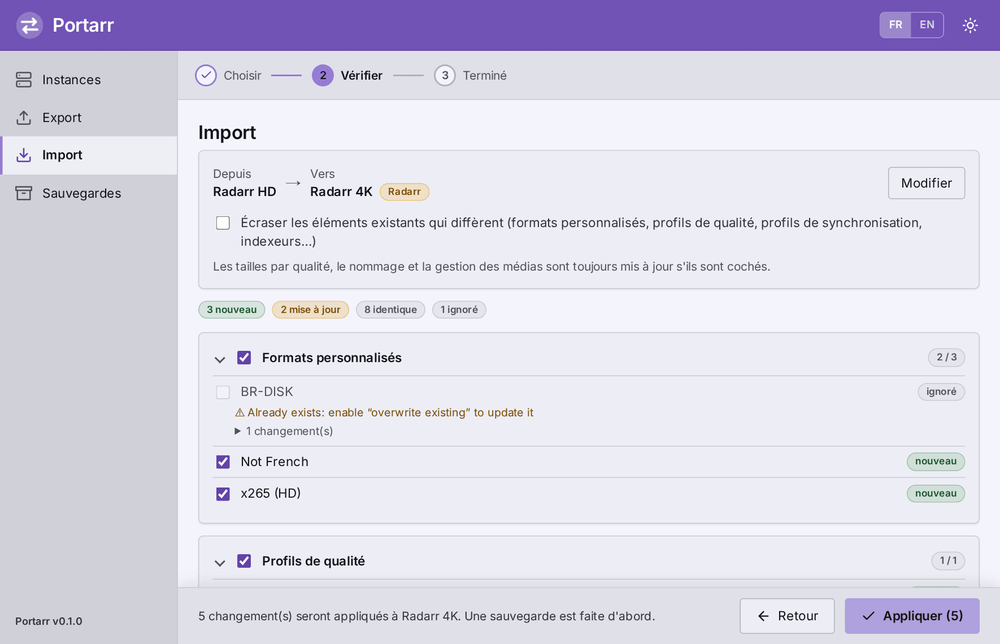
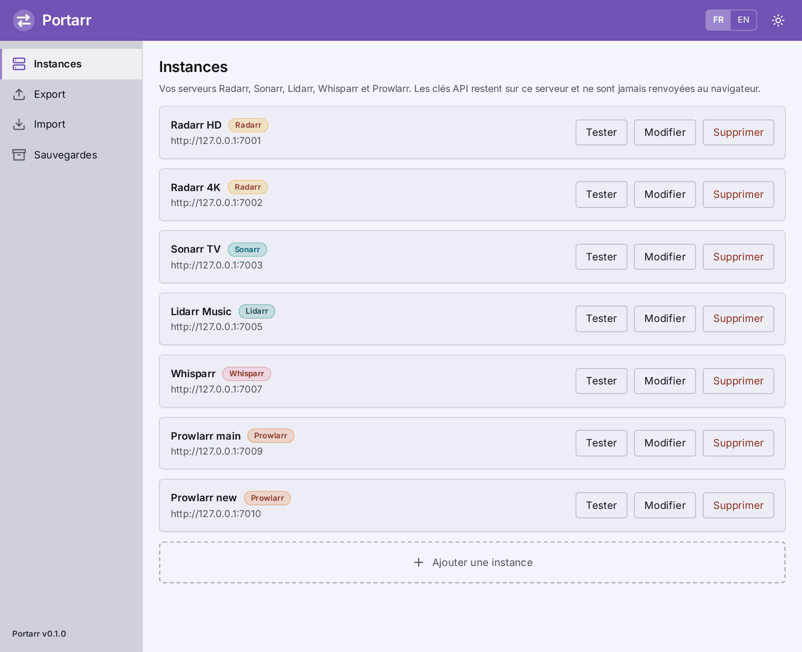
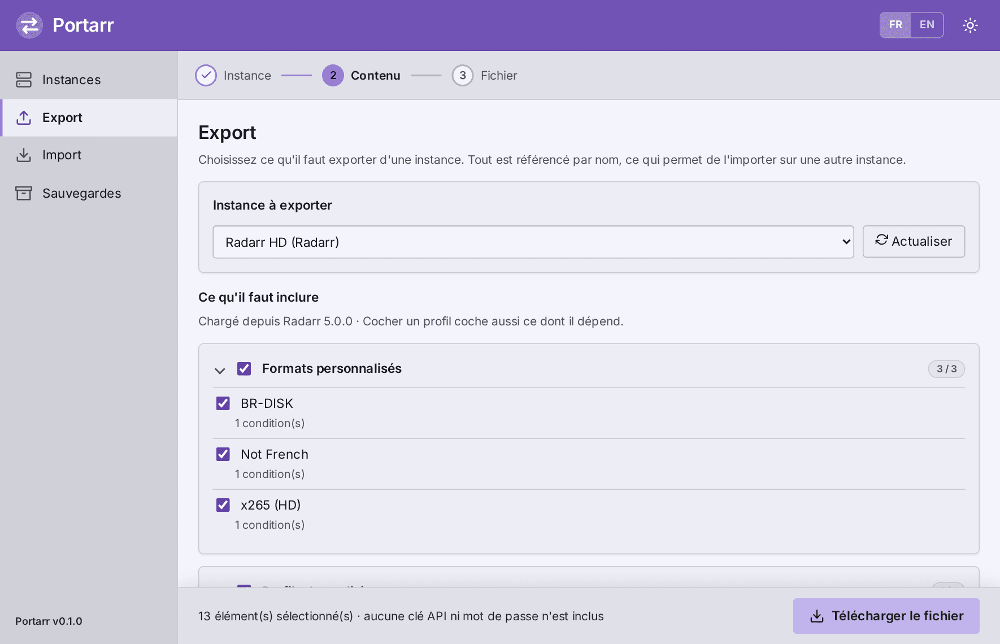
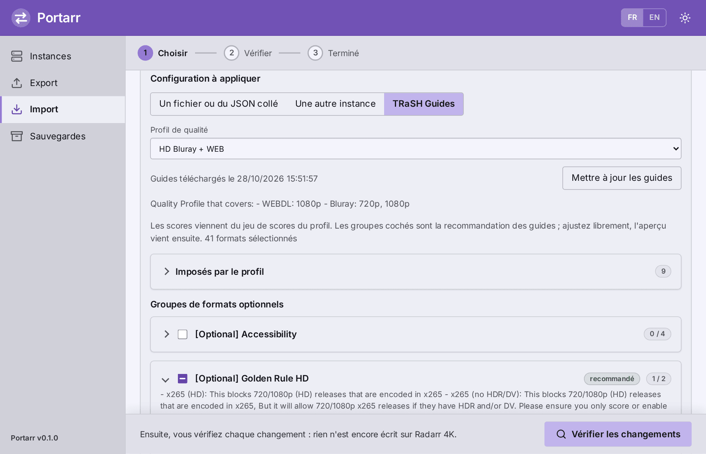
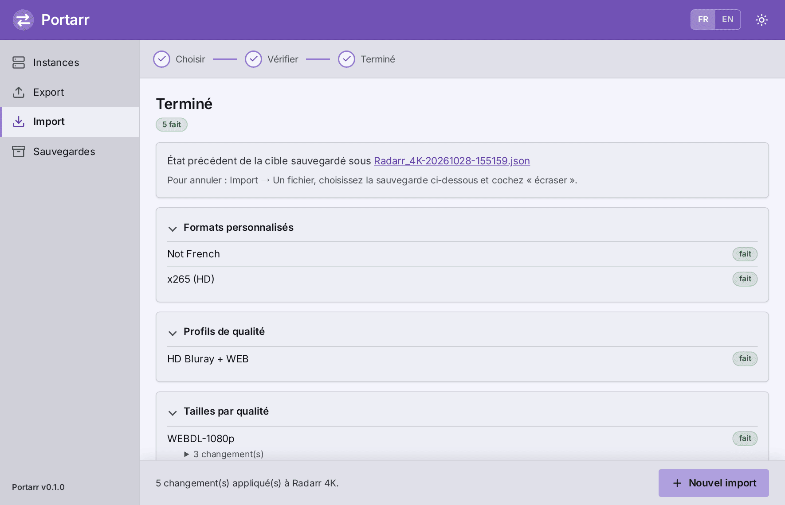
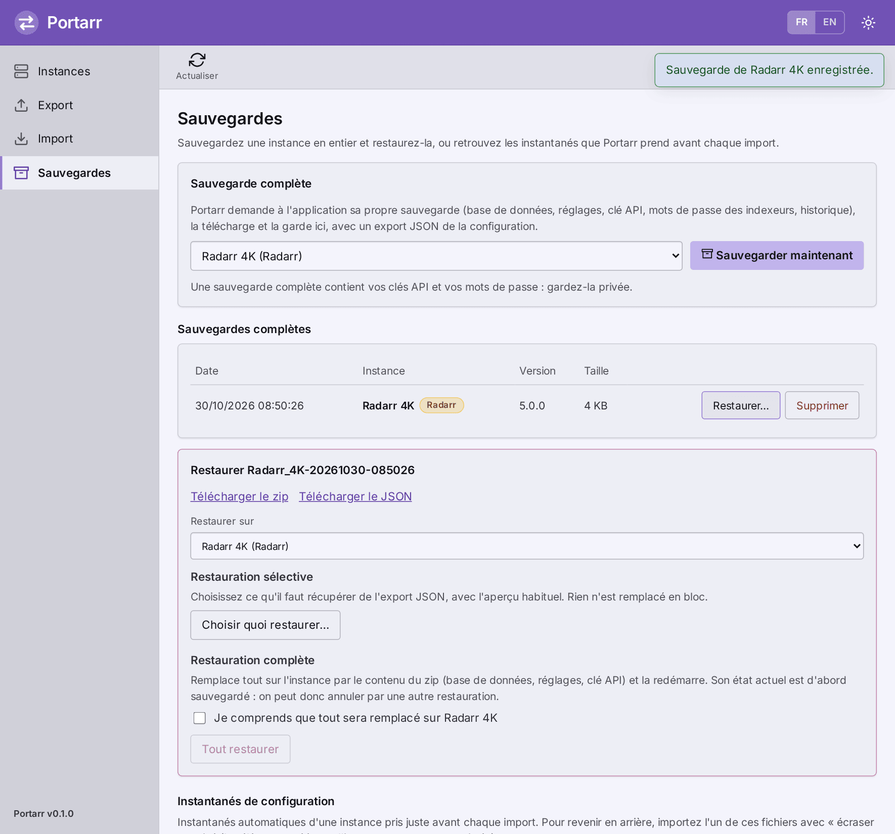
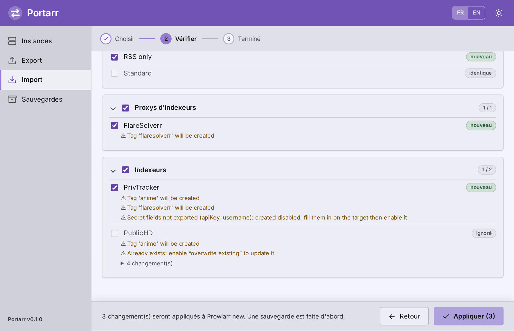

<p align="center"></p>

# Portarr

[English](README.md) · **Français**

Portarr est un petit outil web qui **exporte et importe la configuration qualité de Radarr, Sonarr, Lidarr, Whisparr et Prowlarr**. Il sert à appliquer les [TRaSH Guides](https://trash-guides.info/), copier une configuration d'une instance à une autre, ou la sauvegarder et la partager, sans tout refaire à la main.

<p align="center"></p>

## Fonctionnalités

| Application | Ce qu'on peut exporter et importer |
|---|---|
| Radarr, Sonarr, Lidarr, Whisparr | Formats personnalisés, profils de qualité (scores, groupes, cutoff, langue), tailles par qualité, nommage, gestion des médias |
| Radarr, Sonarr | Profils, tailles par qualité et schémas de nommage des [TRaSH Guides](https://trash-guides.info/), choisis dans le catalogue ou collés en JSON |
| Lidarr | Profils de métadonnées (types d'albums et statuts de sortie) |
| Prowlarr | Profils de synchronisation, indexeurs, proxys d'indexeurs |

- **Des noms, pas des IDs.** Formats, qualités, tags et profils sont référencés par nom : un export d'une instance s'importe sur une autre dont les IDs sont différents.
- **Aperçu d'abord.** Chaque import liste ce qui sera créé, modifié ou ignoré, champ par champ. Vous décochez ce que vous ne voulez pas.
- **Sauvegarde automatique** de la cible, faite juste avant toute écriture. Si elle échoue, rien n'est modifié.
- **Ne supprime jamais** rien sur la cible.
- **Sauvegardes et restaurations complètes** d'une instance entière (la sauvegarde propre de l'application, avec un export JSON de sa configuration), conservées dans Portarr.
- **Sans risque à partager.** Les exports ne contiennent ni clé API ni mot de passe, et les clés de vos instances ne quittent jamais le serveur.
- **Une application vers la même application** uniquement : un export Sonarr est refusé sur Radarr.
- Interface en anglais et en français (sélecteur dans l'en-tête), thème clair et sombre, et le type d'application est détecté à l'ajout d'une instance.

Compatible avec Radarr v4+/v5+, Sonarr v4+, Whisparr v2 et v3 « Eros » (API v3), Lidarr et Prowlarr (API v1).

> Lidarr et Prowlarr ont été validés contre des simulations de leurs spécifications OpenAPI officielles, et Whisparr contre une simulation fondée sur son code source (il ne publie pas de spécification). Aucun n'a encore été essayé sur une vraie instance, pas plus que la sauvegarde et la restauration complètes, qui suivent l'API documentée des applications. Lisez toujours l'aperçu, et essayez d'abord une restauration complète sur une instance que vous pouvez vous permettre de perdre.

Remarques : la gestion des médias est décochée par défaut, et les réglages propres à l'hôte (corbeille, permissions) ne sont jamais exportés. Les tailles par qualité d'un profil de Whisparr v2 sont conservées, sauf pour les qualités d'un groupe. Certains avertissements de l'aperçu viennent des serveurs et ne sont pas encore traduits : ils restent en anglais dans l'interface française.

## Captures d'écran

Les instances ci-dessous sont simulées : aucune donnée réelle n'est affichée.

**Vos instances**, chacune à la couleur de son application :



**Export** : choisissez ce qu'il faut inclure. La configuration se charge toute seule, et le fichier ne contient jamais de clé API ni de mot de passe :



**Import depuis les TRaSH Guides** : choisissez un profil et ajustez ses groupes de formats optionnels, puis éventuellement un jeu de tailles par qualité et un schéma de nommage :



**Terminé** : le résumé, et la sauvegarde automatique de la cible faite juste avant d'écrire :



## Installation

Portarr tourne dans un seul conteneur, sans base de données. Tout ce qu'il retient (vos instances, les sauvegardes, le cache TRaSH) est dans le volume `/config`. Le conteneur tourne par défaut sous l'utilisateur `568:568` (l'utilisateur `apps` de TrueNAS) : `/config` doit donc être inscriptible par lui, ou par l'utilisateur sous lequel vous [lancez le conteneur](#réglages-utiles).

L'image est construite et publiée automatiquement par les GitHub Actions de ce dépôt : `ghcr.io/ali0cha/portarr:latest` (amd64 et arm64).

### Docker Compose

```bash
git clone https://github.com/ali0cha/portarr.git && cd portarr
mkdir -p config && sudo chown 568:568 config
docker compose up -d --build
```

L'image est construite en local, sans registre. Ouvrez <http://localhost:8765>.

### docker run

```bash
docker run -d --name portarr --restart unless-stopped -p 8765:8765 -v portarr-config:/config ghcr.io/ali0cha/portarr:latest
```

Un volume nommé fonctionne sans changer aucun droit. Avec un dossier de l'hôte (`-v /chemin/config:/config`), donnez-le d'abord à l'utilisateur du conteneur : `sudo chown 568:568 /chemin/config`.

### Réglages utiles

- **Authentification** : ajoutez `-e AUTH_USER=admin -e AUTH_PASSWORD=...` (ou les mêmes clés sous `environment:` dans `docker-compose.yml`). Recommandé sauf si le port est réservé à un réseau de confiance.
- **Port** : changez le premier nombre de `-p 8765:8765` (ou de `ports:` dans le compose).
- **Joindre vos instances** : utilisez une adresse que le conteneur peut atteindre, soit l'IP de l'hôte et le port de l'application (`http://192.168.1.10:7878`), soit, sur un réseau Docker commun, le nom du conteneur (`http://radarr:7878`). `localhost` désigne le conteneur Portarr lui-même.
- **Utilisateur** : `568:568` ne convient qu'à TrueNAS. Pour coller à votre système, lancez le conteneur sous un autre utilisateur (`--user 99:100` sur Unraid, `--user 1000:1000` sur la plupart des Linux, ou `user:` dans le compose) et donnez `/config` à cet utilisateur. Portarr n'écrit que dans `/config` et se moque de l'utilisateur utilisé.
- **Droits** : si l'ajout d'une instance échoue avec une erreur HTTP 500 et `Permission denied: '/config/…'` dans le journal, le dossier n'est pas inscriptible par l'utilisateur du conteneur (le journal donne son uid). Corrigez le propriétaire ou l'ACL du dossier.

### Ajouter vos instances

*Instances* → *Ajouter une instance*. Indiquez l'adresse que le conteneur peut atteindre et la clé API de *Paramètres → Général → Sécurité*. Si vous utilisez une URL Base, ajoutez-la (`http://192.168.1.10:7878/radarr`).

| Application | Port par défaut |
|---|---|
| Radarr | 7878 |
| Sonarr | 8989 |
| Lidarr | 8686 |
| Whisparr | 6969 |
| Prowlarr | 9696 |

## Utilisation

Chaque tâche est un parcours en étapes (l'indicateur est en haut), et **toutes les actions sont dans la barre du bas** : on ne fait qu'avancer.

**Exporter une configuration**, pour la réutiliser vous-même ou l'envoyer à quelqu'un :

1. Ouvrez **Export** et choisissez l'instance. Sa configuration se charge toute seule.
2. Décochez ce que vous ne voulez pas. Cocher un profil coche aussi ce dont il dépend.
3. **Téléchargez le fichier.** Gardez-le comme sauvegarde, réimportez-le sur une autre de vos instances, ou envoyez-le.

**Importer une configuration** :

1. **Choisissez** l'instance à configurer, puis d'où vient la configuration : *un fichier ou du JSON collé* (un export Portarr, un format ou un profil TRaSH), *une autre instance* de la même application, ou les *TRaSH Guides* (Radarr et Sonarr). Cliquez sur **Vérifier les changements**.
2. **Vérifiez** la liste de ce qui sera créé, modifié ou ignoré. Décochez ce que vous ne voulez pas, puis **Appliquez**. *Modifier* (ou l'étape 1 de l'indicateur) ramène en arrière sans rien perdre.
3. **Terminé** : le résumé et le lien vers la sauvegarde de la cible.

**Annuler un import** : ouvrez **Sauvegardes**, puis réimportez le fichier voulu (*Import → Un fichier*) avec *écraser* coché. Les éléments créés entre-temps ne sont pas supprimés. Pour revenir en arrière pour de bon, utilisez une [sauvegarde complète](#sauvegarde-et-restauration-complètes).

*Écraser les éléments existants* concerne les éléments appariés par nom : formats personnalisés, profils de qualité, profils de synchronisation, indexeurs et proxys. Les tailles par qualité, le nommage et la gestion des médias sont toujours mis à jour s'ils sont cochés.

### Profils, tailles et nommage TRaSH Guides

Un profil TRaSH ne contient que des *références* : ses formats obligatoires sont nommés, et leurs scores se trouvent dans le fichier de chaque format, selon le *jeu de scores* du profil. Portarr résout tout cela :

1. Il télécharge une fois le [dépôt des guides](https://github.com/TRaSH-Guides/Guides) (environ 25 Mo, dont il ne garde que 1,2 Mo de JSON) et le garde 12 heures dans `/config/cache`.
2. Pour le profil choisi, il rassemble les formats obligatoires et les groupes optionnels qui s'y appliquent, avec chaque score. Ce que recommandent les guides est coché d'office.
3. Il construit un export Portarr complet (profil, scores, définitions des formats) qui passe par l'aperçu et la sauvegarde habituels.

Les qualités gardent l'ordre des guides, et toute qualité que le guide ne mentionne pas est ajoutée en bas, désactivée.

Les trois choix sont indépendants, et chacun peut rester sur *Aucun* : vous pouvez n'importer qu'un profil, que les tailles, ou que le nommage.

- **Les tailles par qualité** sont la taille minimale, préférée et maximale de chaque qualité selon les guides (Mo par minute de durée), en un jeu par type de bibliothèque : films, anime, profils SQP pour Radarr ; séries et anime pour Sonarr. Les qualités que le jeu ne liste pas gardent leurs tailles actuelles, et celles que la cible ne connaît pas sont ignorées avec une remarque.
- **Le schéma de nommage** règle les formats de nom des dossiers et des fichiers pour le serveur multimédia que vous utilisez (Plex, Emby ou Jellyfin, avec des identifiants IMDb, TMDb ou TVDb), ou les variantes *titre original* et *P2P / scene* des guides. Les formats qu'il applique sont affichés avant de continuer. Il n'active jamais le renommage : s'il est désactivé sur la cible, l'aperçu le signale.

- **Un accès Internet est nécessaire** la première fois et pour *Mettre à jour les guides*. Hors ligne, la copie en cache est utilisée même périmée. Coller des formats personnalisés fonctionne hors ligne.
- **Radarr et Sonarr uniquement** : les guides ne couvrent rien d'autre.
- Le fichier de *conflits* des guides n'est pas appliqué. Lisez la description de chaque groupe (par exemple, ne scorez qu'un seul des deux formats x265).
- `TRASH_GUIDES_URL` désigne une autre archive, par exemple un miroir.

### Sauvegarde et restauration complètes

Les exports et imports déplacent une *configuration*. Une **sauvegarde complète** copie l'instance entière, pour la retrouver après une mise à jour ratée, une base abîmée ou un déménagement vers une autre machine.

**Sauvegarder** : ouvrez **Sauvegardes**, choisissez une instance et cliquez sur **Sauvegarder maintenant**. Portarr demande à l'application de faire sa propre sauvegarde (le zip que vous obtiendriez par *Système → Sauvegardes* : base de données, réglages, clé API, mots de passe des indexeurs, historique), la télécharge et la garde dans `/config/backups/full/`, avec un export JSON de la configuration pris au même moment. La copie restée sur l'application n'est pas supprimée.

**Restaurer** : cliquez sur **Restaurer…** à côté d'une sauvegarde, puis choisissez :

- **Restauration complète** renvoie le zip à l'application, qui remplace *tout* par son contenu et redémarre. Cochez d'abord la confirmation. La cible est sauvegardée de la même façon juste avant (elle apparaît comme *avant une restauration*), et rien n'est touché si cela échoue : une restauration s'annule donc en restaurant cette sauvegarde.
- **Restauration sélective** ouvre *Import* avec l'export JSON chargé et *écraser* coché : vous choisissez ce qu'il faut récupérer, avec l'aperçu habituel.

Bon à savoir :

- Une sauvegarde se restaure sur une instance **de la même application**, qui peut être une autre instance que celle d'origine, et pas sur une version plus ancienne que celle qui l'a faite.
- La sauvegarde restaurée ramène sa propre clé API. Si elle diffère de celle que Portarr a gardée, Portarr le dit : modifiez l'instance et saisissez la clé actuelle.
- Un zip contient vos clés API et les mots de passe des indexeurs. Traitez `/config` et les fichiers téléchargés comme des secrets, et définissez `AUTH_USER` et `AUTH_PASSWORD`.
- Les sauvegardes s'accumulent jusqu'à ce que vous les supprimiez (bouton *Supprimer*). Leur taille est celle de la sauvegarde de l'application, en général quelques Mo.



### Secrets des indexeurs Prowlarr

Prowlarr masque les clés API, mots de passe et noms d'utilisateur dans son API : ils **ne peuvent pas être exportés**. Portarr ne les écrit jamais dans un fichier. À l'import :

- un **nouvel** indexeur qui en a besoin est créé **désactivé**, sans test de connexion, qui échouerait. Renseignez ses secrets sur la cible, puis activez-le ;
- un indexeur **existant** conserve ses secrets, et son état activé n'est pas modifié s'il en a ;
- les indexeurs publics n'ont pas de secrets et sont créés normalement.

Les *Applications* (les liens Prowlarr → Radarr/Sonarr, qui contiennent des clés API) et les clients de téléchargement ne sont volontairement pas gérés : ils dépendent de votre environnement.



## Mise à jour

| Installation | Commande ou action |
|---|---|
| Docker Compose | `git pull && docker compose up -d --build` |
| docker run | `docker pull ghcr.io/ali0cha/portarr:latest`, puis supprimez et recréez le conteneur (le volume est conservé) |

L'image publiée ne change que lorsque la dernière construction de l'onglet **Actions** de ce dépôt est verte. Pour savoir ce qui tourne, lisez le bas de la barre latérale : la **version** et le **commit** dont l'image a été construite (par exemple `build a1b2c3d`). Une image construite à la main affiche `build dev`.

**Avis de mise à jour.** En bas de la barre latérale, une coche verte à côté de la version confirme que vous êtes à jour (survolez-la pour le détail). Quand une version plus récente existe, un lien apparaît à la place, sous la version. Portarr compare son `__version__` à celui de la branche `main` de ce dépôt : une toute petite requête vers `raw.githubusercontent.com`, au plus toutes les 6 heures, qui n'envoie rien sur vous ni sur vos instances. Hors ligne, ou avec la vérification désactivée, ni la coche ni le lien ne s'affichent, faute de pouvoir comparer. Le lien peut apparaître quelques minutes avant la publication de la nouvelle image : vérifiez d'abord que la construction est verte. `PORTARR_UPDATE_CHECK=0` la désactive.

Vos instances et vos sauvegardes sont dans `/config` et survivent aux mises à jour.

## Référence

### Sécurité

Portarr détient les clés API de vos instances, et ses sauvegardes complètes aussi. Gardez-le sur votre réseau local et définissez `AUTH_USER` et `AUTH_PASSWORD` (authentification HTTP basique) sauf si le port est réservé à un réseau de confiance. Ne l'exposez pas directement sur Internet ; placez-le derrière un reverse proxy HTTPS si nécessaire. `/healthz` reste public.

### Variables d'environnement

| Variable | Défaut | Rôle |
|---|---|---|
| `PORT` | `8765` | Port d'écoute dans le conteneur |
| `CONFIG_DIR` | `/config` | `instances.json` (mode 600), `backups/` et `cache/` |
| `TRASH_GUIDES_URL` | archive GitHub du dépôt TRaSH | Adresse de l'archive `.tar.gz` des guides |
| `PORTARR_UPDATE_CHECK` | `1` | Mettre à `0` pour ne plus chercher de nouvelle version |
| `PORTARR_REPO` | `ali0cha/portarr` | Dépôt lu par la vérification et vers lequel pointe le lien (pour un fork) |
| `PORTARR_UPDATE_URL` | branche `main` de `PORTARR_REPO` | Adresse du fichier contenant le dernier `__version__` |
| `AUTH_USER`, `AUTH_PASSWORD` | vides | Activent l'authentification si les deux sont définies |

### Format du fichier d'export

JSON lisible et versionné (`"format": "portarr"`, `"version": 1`). Les profils référencent les formats et les qualités par nom :

```json
{
  "qualityProfiles": [{
    "name": "HD Bluray + WEB",
    "cutoff": "WEB 1080p",
    "items": [{"name": "WEB 1080p", "allowed": true, "items": ["WEBDL-1080p", "WEBRip-1080p"]}],
    "formatItems": [{"name": "x265 (HD)", "score": -10000}]
  }]
}
```

### Design

L'interface reprend la structure de la dernière version de Sonarr : en-tête coloré, barre latérale, cartes, police Inter et palette OKLCH claire / sombre. Chaque application de la suite [Servarr](https://wiki.servarr.com/) a sa teinte (Sonarr cyan, Radarr jaune, Lidarr vert, Readarr rouge sombre, Prowlarr orange, Whisparr rose), et **Portarr prend la teinte libre, le violet**. Les badges d'instance gardent la couleur de leur application. Le logo est [`app/static/logo.svg`](app/static/logo.svg). La police Inter (SIL OFL, voir `app/static/fonts/LICENSE-Inter.txt`) est embarquée : rien n'est chargé depuis Internet.

## Développement

Le backend est du FastAPI (`app/`) et le frontend du JavaScript simple, sans étape de build (`app/static/`).

```bash
./run_tests.sh                                   # tests dans un conteneur Python jetable
python -m tests.fake_arr radarr-a:7001 radarr-b:7002 sonarr-a:7003 sonarr-b:7004 lidarr-a:7005 lidarr-b:7006 whisparr-a:7007 whisparr-b:7008 prowlarr-a:7009 prowlarr-b:7010
                                                 # faux serveurs, clé « demo-key » : un « -a » rempli et un « -b » cible par application
python -m tests.fake_trash 7100                  # mini dépôt TRaSH hors ligne (TRASH_GUIDES_URL=http://127.0.0.1:7100/Guides.tar.gz)
CONFIG_DIR=./config python -m app                # l'application sur http://localhost:8765
./tools/screenshots/run.sh                       # régénère docs/screenshots (Docker et Internet requis)
```

- `tests/fake_arr.py` simule les API en mémoire (noms uniques, cutoffs valides, IDs de formats, secrets masqués, `forceSave`). Les tests couvrent l'aller-retour entre deux instances aux IDs différents, l'idempotence d'un second import et l'absence de secrets dans les exports.
- Les textes de l'interface sont dans la table `I18N` de `app/static/app.js`. `tests/test_i18n.py` garde l'anglais et le français alignés, et `tests/test_readmes.py` fait de même pour les deux README.
- `docs/screenshots/` est généré par `tools/screenshots/run.sh` (la vraie application, les faux serveurs et Chromium sans interface). Régénérez-le après une modification de l'interface.
- Pour publier une nouvelle version, changez `__version__` dans `app/__init__.py`. La construction GitHub ajoute le commit, et les installations affichent le lien de mise à jour dès que `main` porte le nouveau numéro.

## Licence

Portarr est publié sous [licence MIT](LICENSE). Les changements de chaque version sont listés dans le [journal des changements](CHANGELOG.md).

## Pistes d'évolution

Prise en compte du fichier de conflits TRaSH, profils de délai, release profiles (Sonarr, Lidarr), Readarr, synchronisation avec suppression, traduction des messages renvoyés par les serveurs.
