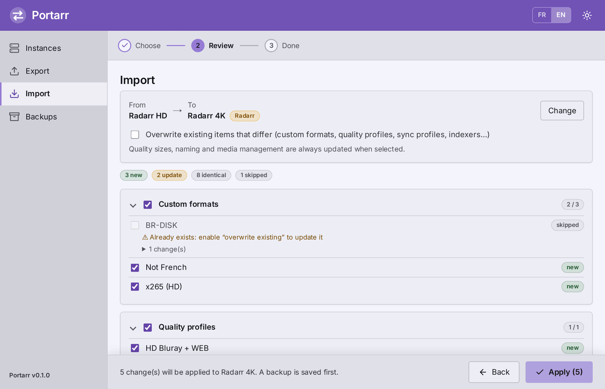
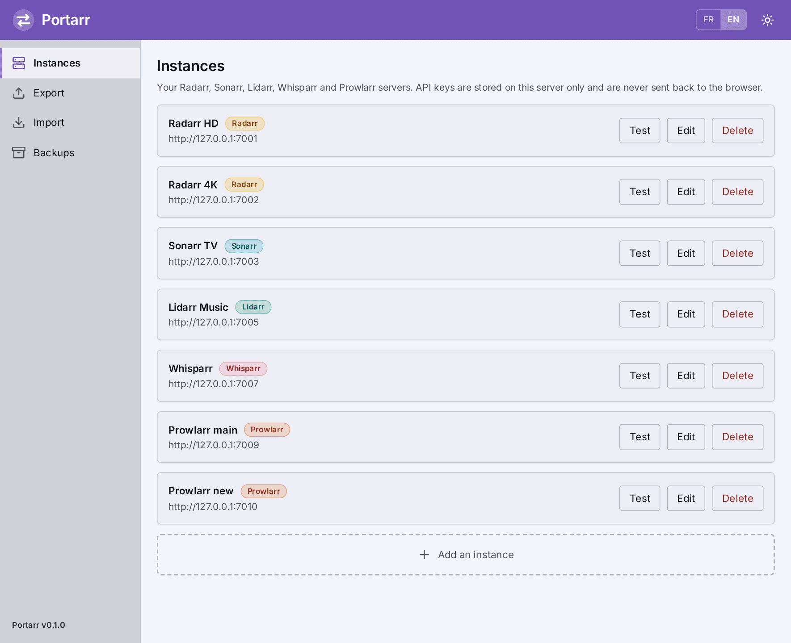
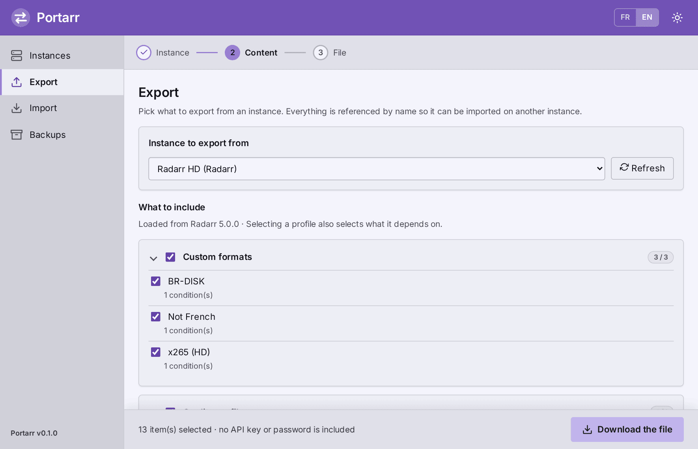
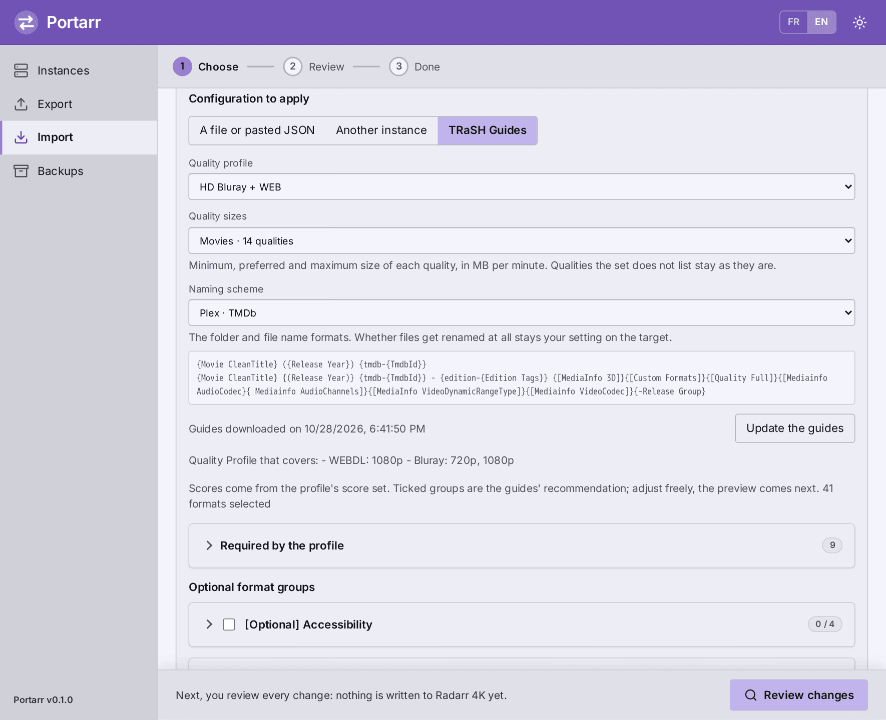
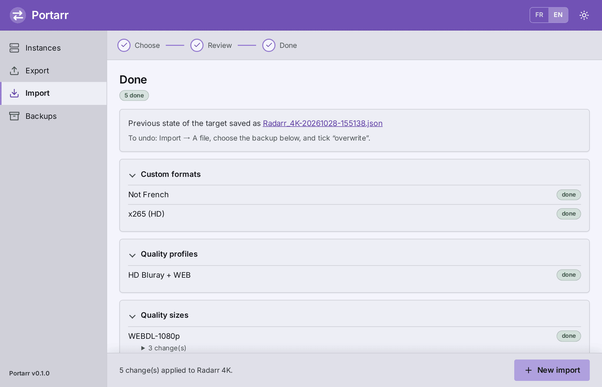
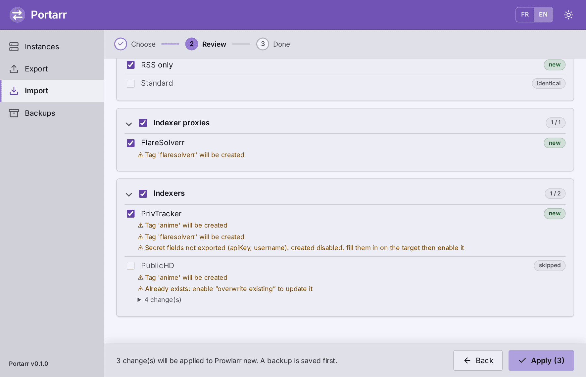

<p align="center"></p>

# Portarr

**English** · [Français](README.fr.md)

Portarr is a small web tool that **exports and imports the quality configuration of Radarr, Sonarr, Lidarr, Whisparr and Prowlarr**. Use it to apply the [TRaSH Guides](https://trash-guides.info/), copy a setup from one instance to another, or back up and share a configuration, without redoing it by hand.

<p align="center"></p>

## Features

| Application | What you can export and import |
|---|---|
| Radarr, Sonarr, Lidarr, Whisparr | Custom formats, quality profiles (scores, groups, cutoff, language), quality sizes, naming, media management |
| Radarr, Sonarr | [TRaSH Guides](https://trash-guides.info/) profiles, quality sizes and naming schemes, picked from the catalogue or pasted as JSON |
| Lidarr | Metadata profiles (album types and release statuses) |
| Prowlarr | Sync profiles, indexers, indexer proxies |

- **Names, not IDs.** Formats, qualities, tags and profiles are referenced by name, so an export from one instance imports into another where the IDs differ.
- **Preview first.** Every import lists what will be created, updated or skipped, field by field. You untick what you don't want.
- **Automatic backup** of the target, saved right before anything is written. If the backup fails, nothing is changed.
- **Never deletes** anything on the target.
- **Safe to share.** Exports contain no API key or password, and your instances' keys never leave the server.
- **Same application to same application** only: an export from Sonarr is refused on Radarr.
- English and French interface (switch in the header), light and dark theme, and the application type is detected when you add an instance.

Works with Radarr v4+/v5+, Sonarr v4+, Whisparr v2 and v3 "Eros" (API v3), Lidarr and Prowlarr (API v1).

> Lidarr and Prowlarr were validated against simulations of their official OpenAPI specifications, and Whisparr against one based on its source code (it publishes no specification). None has been tried on a real instance yet. Always read the preview; the automatic backup covers the rest.

Notes: media management is unticked by default, and host-specific settings (recycle bin, permissions) are never exported. Whisparr v2's per-quality size limits inside a profile are kept, except for qualities inside a group. Some preview warnings come from the servers and are not translated yet: they stay in English in the French interface.

## Screenshots

The instances below are simulated, so no real data is shown.

**Your instances**, each in its application's colour:



**Export**: pick what to include. The configuration loads by itself, and the file never contains an API key or a password:



**Import from the TRaSH Guides**: pick a profile and adjust its optional format groups, and optionally a set of quality sizes and a naming scheme:



**Done**: the summary, and the automatic backup of the target made right before writing:



## Install

Portarr runs as a single container with no database. Everything it remembers (your instances, the backups, the TRaSH cache) lives in the `/config` volume, which **must be writable by user `568:568`**.

The image is built and published automatically by this repository's GitHub Actions: `ghcr.io/ali0cha/portarr:latest` (amd64 and arm64).

### Docker Compose

```bash
git clone https://github.com/ali0cha/portarr.git && cd portarr
mkdir -p config && sudo chown 568:568 config
docker compose up -d --build
```

This builds the image locally, with no registry. Open <http://localhost:8765>.

### docker run

```bash
docker run -d --name portarr --restart unless-stopped -p 8765:8765 -v portarr-config:/config ghcr.io/ali0cha/portarr:latest
```

A named volume works without any permission change. With a host folder (`-v /path/config:/config`), run `sudo chown 568:568 /path/config` first.

Useful settings:

- **Authentication**: add `-e AUTH_USER=admin -e AUTH_PASSWORD=...` (or the same keys under `environment:` in `docker-compose.yml`). Recommended unless the port is limited to a trusted network.
- **Port**: change the first number of `-p 8765:8765` (or of `ports:` in the compose file).
- **Reaching your instances**: use an address the container can reach, either the host's IP and the application's port (`http://192.168.1.10:7878`) or, on a shared Docker network, the container name (`http://radarr:7878`). `localhost` is the Portarr container itself.
- **Permissions**: if adding an instance fails with an HTTP 500 and `Permission denied: '/config/…'` in the log, the folder is not writable by uid 568. Fix its owner or ACL.

### Adding your instances

*Instances* → *Add instance*. Give the address the container can reach and the API key from *Settings → General → Security*. If you use a URL Base, include it (`http://192.168.1.10:7878/radarr`).

| Application | Default port |
|---|---|
| Radarr | 7878 |
| Sonarr | 8989 |
| Lidarr | 8686 |
| Whisparr | 6969 |
| Prowlarr | 9696 |

## Using Portarr

Every task is a step-by-step path (the indicator is at the top), and **all actions are in the bottom bar**, so you only move forward.

**Export a configuration**, to reuse it yourself or send it to someone:

1. Open **Export** and pick the instance. Its configuration loads by itself.
2. Untick what you don't want. Ticking a profile also ticks what it depends on.
3. **Download the file.** Keep it as a backup, re-import it on another of your instances, or send it.

**Import a configuration**:

1. **Choose** the instance to configure, then where the configuration comes from: *a file or pasted JSON* (a Portarr export, a TRaSH custom format or profile), *another instance* of the same application, or the *TRaSH Guides* (Radarr and Sonarr). Click **Review changes**.
2. **Review** the list of what will be created, updated or skipped. Untick what you don't want, then **Apply**. *Change* (or step 1 of the indicator) goes back without losing anything.
3. **Done**: the summary and the link to the backup of the target.

**Roll back**: open **Backups**, then re-import the file you want (*Import → A file*) with *overwrite* ticked. Items created in the meantime are not deleted.

*Overwrite existing items* applies to items matched by name: custom formats, quality profiles, sync profiles, indexers and proxies. Quality sizes, naming and media management are always updated when ticked.

### TRaSH Guides profiles, sizes and naming

A TRaSH profile only holds *references*: its mandatory formats are named, and their scores live in each format's own file under the profile's *score set*. Portarr resolves all of it:

1. It downloads the [guides' repository](https://github.com/TRaSH-Guides/Guides) once (about 25 MB, of which it keeps 1.2 MB of JSON) and caches it for 12 hours in `/config/cache`.
2. For the chosen profile it gathers the mandatory formats and the optional groups that apply, with each score. What the guides recommend is ticked by default.
3. It builds a complete Portarr export (profile, scores, format definitions) that goes through the usual preview and backup.

Qualities keep the guides' order, and any quality the guide doesn't mention is added at the bottom, disabled.

The three choices are independent, and each one can be left on *None*: you can import only a profile, only the sizes, or only the naming.

- **Quality sizes** are the guides' minimum, preferred and maximum size of each quality (MB per minute of runtime), in one set per kind of library: movies, anime, the SQP profiles for Radarr; series and anime for Sonarr. Qualities the set doesn't list keep their current sizes, and qualities the target doesn't know are skipped with a note.
- **Naming scheme** sets the folder and file name formats for the media server you use (Plex, Emby or Jellyfin, with IMDb, TMDb or TVDb IDs), or the guides' *original title* and *P2P / scene* variants. The formats it will set are shown before you continue. It never switches renaming on: if renaming is off on the target, the preview says so.

- **Internet access is needed** the first time and for *Update the guides*. Offline, the cached copy is used even if outdated. Pasting custom formats works offline.
- **Radarr and Sonarr only**: the guides cover nothing else.
- The guides' *conflicts* file is not enforced. Read each group's description (for example, score only one of the two x265 formats).
- `TRASH_GUIDES_URL` points to another archive, such as a mirror.

### Prowlarr indexer secrets

Prowlarr masks API keys, passwords and usernames in its API, so they **cannot be exported**. Portarr never writes them to a file. On import:

- a **new** indexer that needs them is created **disabled**, without a connection test, which would fail. Fill in its secrets on the target, then enable it;
- an **existing** indexer keeps its secrets, and its enabled state is left alone if it has any;
- public indexers have no secrets and are created normally.

*Applications* (the Prowlarr → Radarr/Sonarr links, which hold API keys) and download clients are deliberately not handled: they depend on your environment.



## Updating

| Setup | Command or action |
|---|---|
| Docker Compose | `git pull && docker compose up -d --build` |
| docker run | `docker pull ghcr.io/ali0cha/portarr:latest`, then remove and recreate the container (the volume is kept) |

The published image only changes when the latest build in this repository's **Actions** tab is green. To check what is running, read the bottom of the sidebar: the **version** and the **commit** the image was built from (for example `build a1b2c3d`). An image built by hand shows `build dev`.

**Update notice.** At the bottom of the sidebar, a green check mark next to the version confirms you are up to date (hover it for the details). When a newer version exists, a link appears under the version instead. Portarr compares its `__version__` with the one on this repository's `main` branch: a tiny request to `raw.githubusercontent.com`, made at most every 6 hours, that sends nothing about you or your instances. Offline, or with the check turned off, neither is shown, since Portarr cannot tell. The link can appear a few minutes before the new image is published, so check that the build is green first. Set `PORTARR_UPDATE_CHECK=0` to turn it off.

Your instances and backups live in `/config` and survive updates.

## Reference

### Security

Portarr holds your instances' API keys. Keep it on your local network, and set `AUTH_USER` and `AUTH_PASSWORD` (HTTP basic authentication) unless the port is limited to a trusted network. Don't expose it directly to the Internet; put it behind an HTTPS reverse proxy if you must. `/healthz` stays public.

### Environment variables

| Variable | Default | Purpose |
|---|---|---|
| `PORT` | `8765` | Listening port inside the container |
| `CONFIG_DIR` | `/config` | `instances.json` (mode 600), `backups/` and `cache/` |
| `TRASH_GUIDES_URL` | GitHub archive of the TRaSH repository | Address of the guides' `.tar.gz` archive |
| `PORTARR_UPDATE_CHECK` | `1` | Set to `0` to stop checking for a newer version |
| `PORTARR_REPO` | `ali0cha/portarr` | Repository the update check reads and links to (for a fork) |
| `PORTARR_UPDATE_URL` | `main` branch of `PORTARR_REPO` | Address of the file holding the latest `__version__` |
| `AUTH_USER`, `AUTH_PASSWORD` | empty | Enable authentication when both are set |

### Export file format

Readable, versioned JSON (`"format": "portarr"`, `"version": 1`). Profiles reference formats and qualities by name:

```json
{
  "qualityProfiles": [{
    "name": "HD Bluray + WEB",
    "cutoff": "WEB 1080p",
    "items": [{"name": "WEB 1080p", "allowed": true, "items": ["WEBDL-1080p", "WEBRip-1080p"]}],
    "formatItems": [{"name": "x265 (HD)", "score": -10000}]
  }]
}
```

### Design

The interface follows the structure of the latest Sonarr: coloured header, sidebar, cards, Inter font and a light / dark OKLCH palette. Each [Servarr](https://wiki.servarr.com/) application has its own hue (Sonarr cyan, Radarr yellow, Lidarr green, Readarr dark red, Prowlarr orange, Whisparr pink), and **Portarr takes the free one, violet**. Instance badges keep their application's colour. The logo is [`app/static/logo.svg`](app/static/logo.svg). The Inter font (SIL OFL, see `app/static/fonts/LICENSE-Inter.txt`) is bundled, so nothing is loaded from the Internet.

## Development

The backend is FastAPI (`app/`) and the frontend is plain JavaScript with no build step (`app/static/`).

```bash
./run_tests.sh                                   # tests in a throwaway Python container
python -m tests.fake_arr radarr-a:7001 radarr-b:7002 sonarr-a:7003 sonarr-b:7004 lidarr-a:7005 lidarr-b:7006 whisparr-a:7007 whisparr-b:7008 prowlarr-a:7009 prowlarr-b:7010
                                                 # fake servers, key "demo-key": a populated "-a" and a target "-b" per application
python -m tests.fake_trash 7100                  # offline mini TRaSH repository (TRASH_GUIDES_URL=http://127.0.0.1:7100/Guides.tar.gz)
CONFIG_DIR=./config python -m app                # the app on http://localhost:8765
./tools/screenshots/run.sh                       # regenerate docs/screenshots (needs Docker and Internet)
```

- `tests/fake_arr.py` simulates the APIs in memory (unique names, valid cutoffs, format IDs, masked secrets, `forceSave`). The tests cover the round trip between two instances with different IDs, the idempotence of a second import, and the absence of secrets in exports.
- Interface texts are in the `I18N` table of `app/static/app.js`. `tests/test_i18n.py` keeps English and French in step, and `tests/test_readmes.py` does the same for the two READMEs.
- `docs/screenshots/` is generated by `tools/screenshots/run.sh` (the real app, the fake servers and headless Chromium). Regenerate it after a change to the interface.
- To release a new version, change `__version__` in `app/__init__.py`. The GitHub build adds the commit, and installations show the update link once `main` has the new number.

## License

Portarr is released under the [MIT License](LICENSE). The changes of each release are listed in the [changelog](CHANGELOG.md).

## Ideas for later

Honouring the TRaSH conflicts file, delay profiles, release profiles (Sonarr, Lidarr), Readarr, sync with deletion, translating the messages returned by the servers.
